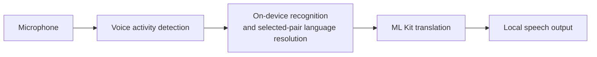

# Offline Conversation Translator

**Two people. One Android phone. A conversation across languages — with recognition, translation and speech running on the device.**

Created by **[Daniil Sterkhov · Ngoroth](https://github.com/Ngoroth)** as a showcase of human-directed software development with AI agents.

> **Status:** working development project, not a production-qualified release. Language resources must be prepared online before offline use. Available speech languages depend on the device and its installed services.

## See it working

<p>
  
  
  
</p>

[Language preparation help](docs/media/language-preparation-help.png) · [Watch the 12-second offline conversation with sound](docs/media/offline-conversation.mp4)


This is the actual app on an emulator with networking disabled and languages already prepared. Recorded test audio enters the real microphone/VAD/recognition path; it is not a live human microphone demonstration. The observed translation and speech output are preserved, including the displayed wording. Only idle waiting before the audio input was trimmed; no inference was sped up. [Capture details, attribution and limits](docs/media/README.md).

## The experience

Choose two languages, prepare their resources, and start a conversation. Either person can speak a turn. The app recognizes the speech, determines its source within the selected pair, translates it, and reads the result aloud. Listening pauses during playback and resumes afterward.

For situations where speaking is inconvenient, **Text** uses the same language pair without starting the microphone or speech pipeline.

- **On-device processing:** the conversation path uses local recognition, ML Kit translation and local speech output. Missing resources do not trigger a cloud fallback.
- **Explicit preparation:** download the required resources before use. Missing, unavailable or failed preparation stays visible rather than being presented as ready.
- **One shared language pair:** change or swap the pair in either Conversation or Text.
- **Replaceable speech backends:** Android on-device recognition and speech output remain the defaults. Explicitly select **Whisper · offline recognition** for one shared multilingual model that selects between the two participants within recognition. NeMo/Parakeet keeps its text-first strategy; legacy Sherpa recognition and Piper output remain available for the curated Russian/English setup.
- **A multilingual interface:** app-owned interface text is localized for the same 17-language catalog.

The catalog is `en`, `vi`, `es`, `id`, `it`, `zh`, `ko`, `de`, `pl`, `pt`, `ru`, `th`, `tr`, `fr`, `hi`, `ja`, `nl`. Chinese means Mainland Simplified Mandarin. Dutch uses `nl` for ML Kit and `nl-NL` for Android recognition/output. Whisper covers the current 17 recognition codes through one shared Small INT8 download; it does not expand Piper voices or install System voices. Parakeet covers `en`, `es`, `fr`, `de`, `it`, `ru`, `nl`, `pl`, `pt` through its own shared model. Coverage is not quality qualification or proof of installed Android resources. Earlier Parakeet NL↔EN, NL↔RU and RU↔EN functional conversations and uncertainty recovery passed on an 8 GiB-configured emulator; its earlier 4 GiB run lost Google TTS to low memory. Those observations do not qualify Whisper or erase known recognition and translation-meaning errors.

## Why this is an AI-agent showcase

The project explores how to take an Android application beyond a generated demo: define the product, integrate real on-device engines, handle resource ownership and cancellation, and check the resulting behavior.

**The author directs the work.** Product goals, constraints and decisions belong to the human; AI agents assist with repository research, implementation, independent review and verification. Current capabilities and unresolved limitations are documented below; internal development journals are kept locally.

Concrete engineering concerns include:

- keeping one conversation pipeline while replacing recognition and speech-output implementations;
- coordinating model preparation, settings changes and engine lifetimes;
- verifying downloaded archives and bounding audio, queues and transcript history;
- distinguishing unit/build checks from actual Android, speech-quality and performance evidence.

Lifecycle, bounded-work and input-limit fixes are summarized in the [changelog](docs/CHANGELOG.md). See the [Android verification guide](docs/testing/verify-translator.md) for current checks.

## How it works



ML Kit can use English as an intermediary for non-English pairs. Source-language resolution follows the explicitly selected recognition backend's policy. Downloads are a separate, explicit preparation step—not part of inference.

Parakeet does not need a separate acoustic language detector or a language hint.
Its recognized text goes to bundled ML Kit Language Identification. Only a
sufficiently confident global result matching one selected language determines
the direction; otherwise the app retains the text, asks for repetition and does
not translate or speak that turn. Unsupported pairs remain unavailable rather
than silently using another provider.

Whisper uses one multilingual Small INT8 model and one encoder per utterance.
The same encoder output feeds a language-token comparison restricted to the two
selected languages and one transcription. It does not run a separate language
classifier or request repetition because the two language scores are close.
Native failures, invalid results and blank text still fail without translation.
Production VAD remains essential: a raw Whisper transcript, including one from
silence, is not by itself proof that someone spoke.

| Component | Responsibility |
| --- | --- |
| `app` | Compose UI, settings, Android speech adapters and runtime ownership |
| `core` | Language/configuration types, engine contracts and conversation processing |
| `engine-mlkit` | On-device text translation and independent bundled text-language identification |
| `speech-models` | Shared strict catalog, verified package storage, download and installation |
| `engine-nemo` | Pinned CPU JNI/Parakeet unconditioned multilingual transcription |
| `engine-sherpa` | Native VAD, joint selected-pair Whisper, retained legacy ASR/LID and Piper synthesis |
| `translator-test-kit` | Shared evaluation inputs and utilities |
| `engine-sherpa-model-smoke` | Isolated Android/JNI model-evaluation runner |
| `build-logic` | Gradle verification tooling, with its own JVM tests |

See the [architecture and extension guide](docs/EXTENSIBILITY.md) for the actual contracts and extension points.

## Build and run

### Requirements

- **JDK 17**, with `JAVA_HOME` configured.
- **Android SDK platform 37.0** (`platforms;android-37.0`), Build Tools **36.0.0** and current SDK command-line tools; set `ANDROID_HOME`.
- An Android **14 / API 34+** emulator or device. The app targets API 36 and packages `arm64-v8a` and `x86_64`.
- **Python 3.12+** and explicitly prepared Sherpa and NeMo native distributions. Native compilation requires Linux x86_64 (including WSL) and the pinned toolchains below; ordinary Gradle builds only verify the prepared distributions.

The checked-in Gradle wrapper supplies Gradle. Building requires network access for build dependencies, but does not download speech models.

**Windows — PowerShell**

```powershell
.\gradlew.bat :engine-sherpa:prepareSherpaArchive --console=plain
```

**Linux / macOS**

```bash
bash ./gradlew :engine-sherpa:prepareSherpaArchive --console=plain
```

The APK is written to `app/build/outputs/apk/debug/app-debug.apk`.

The explicit stock-input command downloads the official Sherpa 1.13.8 AAR (50,129,134 bytes) to `engine-sherpa/libs/sherpa-onnx-1.13.8.aar`, verifies SHA-256 `633c24321e06b1fe79feafa03ea16cbc0f8a286641e2da3559bac91bdb13bd96`, and reuses valid bytes without network access. It is a preparation input, **not** the paired runtime shipped by the app. Corrupt existing input fails unchanged; inspect it explicitly rather than allowing an ordinary build to repair it.

Prepare the selected-pair Sherpa distribution on Linux/WSL before assembly:

```bash
python3 tools/android/prepare-sherpa-native.py \
  --tools-root /absolute/path/to/verified-native-tools \
  --source-cache /absolute/path/to/pinned-native-sources/sherpa \
  --output engine-sherpa/.native-cache/android \
  --abis arm64-v8a x86_64 --download
```

Its [manifest](engine-sherpa/native-build.json) pins source, dependencies, headers
and tools; its [six-file patch](engine-sherpa/native/whisper-language-pair.patch)
adds selected-pair recognition without changing the stock Kotlin/JNI layouts.
The generated `sherpa-onnx-1.13.8-pair-v1.aar` retains the official wrapper and
per-ABI ORT bytes, rebuilds all three Sherpa libraries for both shipped ABIs, and
preserves notices. Its receipt binds actual native bytes, public APIs, 16 KiB
alignment and the explicit retained feature marker. Ordinary builds never fall
back to the official AAR or invoke native compilation. Read-only verification:

```powershell
python tools/android/prepare-sherpa-native.py --verify --output engine-sherpa/.native-cache/android --abis arm64-v8a x86_64
```

Prepare NeMo separately on Linux x86_64, from the repository root, before app
assembly:

```bash
python3 tools/android/prepare-nemo-native.py \
  --tools-root /absolute/path/to/verified-nemo-tools \
  --source-cache engine-nemo/.native-cache/sources \
  --output engine-nemo/.native-cache/android \
  --abis arm64-v8a x86_64 --download
```

The read-only tool root must contain the exact NDK r29 beta1, CMake 4.2.3 and
Ninja 1.13.2 directories pinned in
[`native-build.json`](engine-nemo/native-build.json). The
[host workflow's native preparation step](.github/workflows/host-checks.yml)
downloads the official tool archives, verifies their hashes and lays them out.
The helper independently verifies tool-tree identities; `--download` permits
only missing pinned SDK source archives, never tool or model installation.
Windows can prepare through WSL; macOS/Windows Gradle builds need the complete
verified Linux-prepared distribution at the path above. Copy its generated
receipt and payload together without editing the receipt. Missing, stale,
extra or corrupt artifacts fail closed. See
[NeMo provenance and licenses](engine-nemo/THIRD_PARTY.md).

After both distributions are prepared, assemble with `.\gradlew.bat :app:assembleDebug`
on Windows or `bash ./gradlew :app:assembleDebug` on Linux/macOS.

### Multilingual Whisper recognition

For Dutch Conversation, open Settings, explicitly choose **Whisper · offline
recognition**, Apply, and prepare the selected languages. The shared model has
375,485,327 bytes across three verified raw packages; installation also requires
temporary headroom. It needs neither Android recognition-language packs nor the
legacy independent language-ID model. System output still needs genuine offline
voices for both participants. No model menu or per-turn speaker action is added.

Fresh-install defaults, Reset, settings schemas and previously saved recognition,
output, service and language-ID choices remain unchanged. Selecting Whisper does
not silently replace a saved System, Sherpa or NeMo selection.

After installation:

1. Choose the two languages.
2. Use **Prepare languages** while online and resolve any missing system recognition or voice resources.
3. Wait for readiness, then start Conversation and grant microphone permission—or use Text.
4. To verify offline use, disconnect networking after preparation. Build compatibility alone does not establish device speech-service support.

### Multilingual Parakeet recognition

Select NeMo/Parakeet in the recognition backend settings, apply, and explicitly
prepare the selected pair. This installs one verified 714 MB GGUF for all covered
pairs; it does not depend on Android recognition-language packs. System speech
output is still a separate choice and requires genuinely installed offline
voices in Android's default TTS engine for both selected languages. A usable
text translator does not make an uncovered voice pair ready.

The installed weights occupy about 714 MB. A fresh verified installation needs
about **1.46 GB of free storage** for the download, staged file and safety reserve,
plus the other selected VAD/translation/voice resources. This temporary disk
headroom is separate from the combined inference RAM limit described below.

### Explicit Android recognition service

Advanced **Settings → Recognition service** keeps **Android on-device service** as the default. You can instead select an installed service without relying on the ROM's designated on-device component. Apply saves the choice; Close discards the draft; Reset returns to the designated service without changing the language pair.

Listing a service does not establish readiness for offline conversation. The explicit route accepts only Google **Speech Recognition and Synthesis** component `com.google.android.tts/com.google.android.apps.speech.tts.googletts.service.GoogleTTSRecognitionService`, enabled/exported, with exactly one current signer matching `d22cc500299fb22873a01a010de1c82fbe4d061119b94814dd301dab50cb7678` or `7ce83c1b71f3d572fed04c8d40c5cb10ff75e6d87d9df6fbd53f0468c2905053`. There is no version allowlist. Unknown current signers or other components remain incompatible; removed/disabled saved services stay unavailable without substitution. An update invalidates cached readiness and active operations through the full version/update-time/signer identity; fresh checks are required.

For an admitted Google service, use **Install recognition language data** on Conversation when a selected language is missing. The app opens Google's public confirmation for one missing selected locale. Cancel or return only causes a fresh readiness check; it never starts recording, assumes installation succeeded, or automatically installs the next language. Prepare translation, VAD and local speech output separately with **Prepare languages**. Both recognition languages must actually be installed before Start.

**Recognition and speech output are separate choices.** Selecting Google under **Recognition service** does not select a text-to-speech engine. **System offline speech** still uses Android's default TTS engine, which must provide installed offline voices for both selected languages. For the reported GrapheneOS RU/EN setup, keep Google selected in Android's **Text-to-speech output → Preferred engine** as well as in the app's recognition-service setting. Returning the Android TTS default to GrapheneOS Speech Services was reported to break the conversation; the exact resulting error was not captured. This release does not add an independent in-app TTS-engine selector.

This is a trusted-Google-provider offline-request policy: both selected local languages must be installed, and explicit recognition requests prefer offline processing. Language inventory and `PREFER_OFFLINE` do not attest every requested capability or enforce network isolation inside the provider. The app trusts the authentic Google service to honor that contract; runtime errors or unavailable installer activities fail visibly without app-selected cloud/provider fallback or same-audio retry. Historical binary inspection covered ARM64 210683481 and x86_64 210683483; emulator execution does not prove actual ARM64/GrapheneOS behavior, universal future compatibility, provider-wide telemetry isolation or version-atomic attestation of Android's asynchronously bound process.


The [contributor guide](CONTRIBUTING.md) contains environment setup, the complete host checks and the separate build-logic test command. [Android verification guidance](docs/testing/verify-translator.md) covers opt-in device checks. The [host workflow](.github/workflows/host-checks.yml) runs unit tests, lint and debug APK assembly; its presence is not evidence of a completed GitHub Actions run.

## Known limitations

- **Speech and translation quality are not release-qualified.** Known recognition and meaning errors remain; successful fixtures do not establish all-language or all-direction quality.
- **Conversation is turn-based.** Reliable speech-driven interruption and simultaneous spoken translation are not implemented.
- **Phone performance is not qualified.** Emulator evidence does not establish real microphone/speaker acoustics, sustained-call behavior or the two-second latency target.
- **Memory requirements are not generally qualified.** The same full-pipeline cohort passed on an 8 GiB-configured emulator after the 4 GiB setup killed Google TTS for low memory. This is neither a minimum-RAM guarantee nor phone/resource-pressure qualification; an ASR-only measurement does not budget all prepared components.
- **Offline is not a complete privacy guarantee.** Historical checks found recognized/translated text in ML Kit native logs; this remains unresolved. Do not submit real conversation recordings or raw logs in public reports.
- **Third-party distribution questions remain.** The project license does not automatically cover native binaries, audio fixtures, model/voice weights, datasets or provider branding.

See [native distribution conditions](engine-sherpa/THIRD_PARTY.md#conditions-before-redistributing-this-aar-or-an-apk-containing-it) before redistributing the runtime or an APK containing it.

## Explore the repository

- [Product vision](docs/APP_VISION.md) — intended experience and product requirements.
- [Architecture](docs/EXTENSIBILITY.md) — current structure and extension guidance.
- [Contributing](CONTRIBUTING.md) — setup, checks and safe bug reports.
- [Security policy](SECURITY.md) — reporting guidance and current channel availability.
- [Changelog](docs/CHANGELOG.md) — repository changes.

## License and attribution

Original project materials are licensed under **[Apache-2.0](LICENSE)**. Copyright 2026 **[Daniil Sterkhov · Ngoroth](https://github.com/Ngoroth)** and contributors.

Third-party components retain their own terms. Read [THIRD_PARTY_NOTICES](THIRD_PARTY_NOTICES.md) and [speech-runtime/model provenance](engine-sherpa/THIRD_PARTY.md) before redistributing binaries, recordings or model packages.
