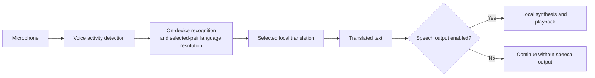

# Offline Conversation Translator

**Two people. One Android phone. A conversation across languages — with recognition, translation and speech running on the device.**

> **Status:** working development project, not a production-qualified release. Language resources must be prepared online before offline use. Available speech languages depend on the device and its installed services.

## See it working

<p>
  
  
  
</p>

[Language preparation help](docs/media/language-preparation-help.png) · [Watch the 12-second offline conversation with sound](docs/media/offline-conversation.mp4)


Recorded on an emulator with networking disabled and languages prepared. Test audio passes through the real recognition, translation and speech pipeline—not a live human microphone demo. [Capture details and limits](docs/media/README.md).

## The experience

Choose two languages, prepare their resources, and start a conversation. Either person can speak a turn; the app recognizes and translates it. The speaker button beside Start/Stop enables or disables reading translations aloud. With speech output enabled, listening resumes after playback; with it disabled, synthesis and playback are skipped. **Text** uses the same language pair without the microphone.

- **Translation choice:** first launch offers Fast (Google ML Kit) or Accurate (Tencent Hy-MT2), with one saved choice for Text and Conversation. These labels describe priorities, not guaranteed speed or correctness.
- **Speech alternatives:** Whisper is the recognition default; Android on-device recognition and System/Piper output remain in Advanced settings. Piper retains its curated Russian/English coverage.
- **Conversation controls:** the pinned lower panel shows actual microphone availability, independently of recognition/translation progress. Speech output is on by default and its choice survives reopening. Mute interrupts current speech without discarding translated text or stopping the conversation; enabling affects subsequent results, not old translations. Unavailable voices leave output off without switching providers or downloading implicitly. For supported Piper languages with missing voice data, Stop and explicitly prepare the voices; preparation keeps output off until you enable it again.
- **17 languages:** a shared language pair across Conversation and Text, with a localized interface.

Basic Settings contains translation choice, interface language and voice speed; Advanced contains recognition/service, output, end-of-speech silence and Reset. Reset immediately restores Tencent, Whisper, System output and speech output on while preserving the language pair, interface language and completed setup. Ordinary Apply and pair changes preserve the latest speaker choice. Opening, choosing or resetting does not download models or record. Current settings use schema 7 only; older schemas are not supported in this development iteration. Schema-7 documents without the speaker flag default to on; older binaries cannot read the newly written field, so downgrading requires restoring their original settings first.

The catalog is `en`, `vi`, `es`, `id`, `it`, `zh`, `ko`, `de`, `pl`, `pt`, `ru`, `th`, `tr`, `fr`, `hi`, `ja`, `nl`. Chinese means Mainland Simplified Mandarin. Dutch uses `nl` for ML Kit and `nl-NL` for Android recognition/output. Whisper covers the current 17 recognition codes through one shared Small INT8 download; it does not expand Piper voices or install System voices. Coverage is not quality qualification or proof of installed Android resources.

## How it works



ML Kit can use English as an intermediary for non-English pairs. Source-language resolution follows the explicitly selected recognition backend's policy. Downloads are a separate, explicit preparation step—not part of inference.

Whisper uses one multilingual Small INT8 model and one encoder per utterance.
The same encoder output feeds a language-token comparison restricted to the two
selected languages and one transcription. It does not run a separate language
classifier or request repetition because the two language scores are close.
Native failures, invalid results and blank text still fail without translation.
Production VAD remains essential: a raw Whisper transcript, including one from
silence, is not by itself proof that someone spoke.

| Component | Responsibility |
| --- | --- |
| `app` | Compose UI, settings, Android speech adapters and runtime ownership |
| `core` | Language/configuration types, engine contracts and conversation processing |
| `engine-mlkit` | On-device text translation and actual Google Task lifetimes |
| `speech-models` | Shared strict catalog, verified package storage, download and installation |
| `engine-tencent` | Shared pinned GGUF preparation and owner-scoped embedded CPU llama.cpp JNI inference |
| `engine-sherpa` | Native VAD, joint selected-pair Whisper, retained evaluator ASR and Piper synthesis |
| `translator-test-kit` | Shared evaluation inputs and utilities |
| `engine-sherpa-model-smoke` | Isolated Android/JNI model-evaluation runner |
| `build-logic` | Gradle verification tooling, with its own JVM tests |

See the [architecture and extension guide](docs/EXTENSIBILITY.md) for the actual contracts and extension points.

## Build and run

- **JDK 17**, with `JAVA_HOME` configured.
- **Android SDK platform 37.0** (`platforms;android-37.0`), Build Tools **36.0.0** and current SDK command-line tools; set `ANDROID_HOME`.
- An Android **14 / API 34+** emulator or device. The app targets API 36 and packages `arm64-v8a` and `x86_64`.
- **Python 3.12+** and explicitly prepared paired Sherpa and Tencent native distributions. Native compilation requires Linux x86_64 (including WSL) and the pinned toolchains below; ordinary Gradle builds only verify the prepared distributions.

Native preparation needs network access but does not download language models. It requires Linux x86_64; on Windows use PowerShell 7 and WSL Ubuntu with Python 3 and Git. See [environment setup](CONTRIBUTING.md#development-environment) for full prerequisites.

**Windows — PowerShell**

```powershell
pwsh -File tools/android/prepare-tencent-native.ps1
.\gradlew.bat :engine-sherpa:prepareSherpaArchive --console=plain
```

**Linux**

```bash
python3 tools/android/prepare-tencent-native.py
bash ./gradlew :engine-sherpa:prepareSherpaArchive --console=plain
```

The APK is written to `app/build/outputs/apk/debug/app-debug.apk`.

The explicit stock-input command downloads the official Sherpa 1.13.8 AAR (50,129,134 bytes) to `engine-sherpa/libs/sherpa-onnx-1.13.8.aar`, verifies SHA-256 `633c24321e06b1fe79feafa03ea16cbc0f8a286641e2da3559bac91bdb13bd96`, and reuses valid bytes without network access. It is a preparation input, **not** the paired runtime shipped by the app. Corrupt existing input fails unchanged; inspect it explicitly rather than allowing an ordinary build to repair it.

Prepare the selected-pair Sherpa distribution on Linux/WSL before assembly:

```bash
python3 tools/android/prepare-sherpa-native.py \
  --tools-root /absolute/path/to/verified-native-tools \
  --source-cache /absolute/path/to/pinned-native-sources/sherpa \
  --output engine-sherpa/.native-cache/android \
  --abis arm64-v8a x86_64 --download
```

Its [manifest](engine-sherpa/native-build.json) pins source, dependencies, headers
and tools; its [six-file patch](engine-sherpa/native/whisper-language-pair.patch)
adds selected-pair recognition without changing the stock Kotlin/JNI layouts.
The generated `sherpa-onnx-1.13.8-pair-v1.aar` retains the official wrapper and
per-ABI ORT bytes, rebuilds all three Sherpa libraries for both shipped ABIs, and
preserves notices. Its receipt binds actual native bytes, public APIs, 16 KiB
alignment and the explicit retained feature marker. Ordinary builds never fall
back to the official AAR or invoke native compilation. Read-only verification:

```powershell
python tools/android/prepare-sherpa-native.py --verify --output engine-sherpa/.native-cache/android --abis arm64-v8a x86_64
```

The read-only Sherpa tool root must contain the exact NDK r29 beta1, CMake 4.2.3
and Ninja 1.13.2 directories pinned in
[`native-build.json`](engine-sherpa/native-build.json). The
[host workflow's preparation step](.github/workflows/host-checks.yml) downloads
the official tool archives, verifies their hashes and lays them out. The helper
independently verifies tool-tree identities; `--download` permits only missing
pinned SDK source archives, never tool or model installation.
Windows can prepare through WSL; macOS/Windows Gradle builds need the complete
verified Linux-prepared distribution. Copy its receipt and payload together
without editing the receipt. Missing, stale, extra or corrupt artifacts fail
closed. See [Sherpa provenance and licenses](engine-sherpa/THIRD_PARTY.md) and
[Tencent preparation](CONTRIBUTING.md#baseline-host-checks).

After both distributions are prepared, assemble with `.\gradlew.bat :app:assembleDebug`
on Windows or `bash ./gradlew :app:assembleDebug` on Linux/macOS.

### Multilingual Whisper recognition

Whisper is selected by default and remains available in Advanced Settings alongside
Android on-device recognition. The shared model has 375,485,327 bytes across three
verified raw packages; installation also requires temporary headroom. It needs
neither Android recognition-language packs nor a separate language-ID model.
System output still needs genuine offline voices for both participants.

The legacy Russian/English Sherpa conversation recognizer and its separate
language-ID path have been retired. The shared sherpa-onnx library, VAD, Piper
and ASR resources used by the isolated evaluation harness remain. First-launch
translation selection is saved atomically with setup completion before either
main route opens; restart does not repeat completed setup.

After installation:

1. Choose the two languages.
2. Use **Prepare languages** while online and resolve missing recognition resources. With speech output enabled, also prepare the selected voices. Switch the speaker button off to converse without output-only voice requirements.
3. Wait for readiness, then start Conversation and grant microphone permission—or use Text.
4. Disconnect networking to use the prepared app offline.

<details>
<summary>Provider preparation and Android recognition</summary>

### Explicit Android recognition service

To use System recognition instead of Whisper, explicitly select it in Settings and Apply. Its **Recognition service** preference defaults to **Android on-device service**; you can explicitly select the supported Google **Speech Recognition and Synthesis** service instead. Both selected recognition languages must be installed; use **Install recognition language data** on Conversation when needed. See [service requirements and offline-policy boundaries](docs/EXTENSIBILITY.md#selected-recognition-and-request-local-routing).

Recognition and speech output are separate choices. **System offline speech**, when enabled, uses Android's default TTS engine and needs offline voices for both languages. Disabling output does not replace missing recognition or translation resources. For the reported GrapheneOS RU/EN setup, keep Google selected in Android's **Text-to-speech output → Preferred engine** as well as in the app's recognition setting. Switching the TTS default back to GrapheneOS Speech Services was reported to break Conversation; the exact error was not captured. There is no in-app TTS-engine selector.

### Tencent model preparation and boundaries

Choose **Accurate · Tencent Hy-MT2** in the shared translation choice; Reset also selects it. Use **Prepare** over Wi-Fi to download the **1.13 GB** model. After reopening, Prepare initializes the verified local model without downloading it again. No model is bundled in the APK.

Tencent remains experimental despite becoming the default. Conversation targets **8 GiB or more RAM**, with phone performance still unqualified. Known output errors affect meaning, including dates and negation—verify important details. See the [pinned model identity](engine-tencent/THIRD_PARTY.md) and [results, resource limits and verification boundaries](docs/testing/verify-translator.md#tencent-specific-preparation-and-native-checks).

</details>

## Known limitations

- **Quality is not release-qualified.** Recognition and translation can change meaning; verify important details.
- **Conversation is turn-based.** Simultaneous translation and reliable interruption by speaking are not implemented.
- **Phone performance is unqualified.** Emulator checks do not establish real microphone/speaker behavior, sustained use or the two-second latency target.
- **Offline does not guarantee privacy.** Recognized/translated text was found in ML Kit native logs; this remains unresolved. Do not post private recordings or raw logs.
- **Third-party terms still apply.** The project license does not automatically cover runtimes, recordings, models, voices or provider branding.

See [native distribution conditions](engine-sherpa/THIRD_PARTY.md#conditions-before-redistributing-this-aar-or-an-apk-containing-it) before redistributing the runtime or an APK containing it.

## Explore the repository

- [Product vision](docs/APP_VISION.md) — intended experience and product requirements.
- [Architecture](docs/EXTENSIBILITY.md) — current structure and extension guidance.
- [Contributing](CONTRIBUTING.md) — setup, checks and safe bug reports.
- [Security policy](SECURITY.md) — reporting guidance and current channel availability.
- [Changelog](docs/CHANGELOG.md) — repository changes.
- [Android verification](docs/testing/verify-translator.md) — device checks and the limits of existing evidence.

## Development

Created by **[Daniil Sterkhov · Ngoroth](https://github.com/Ngoroth)** with AI-agent assistance in research, implementation, review and verification. Product direction and decisions remain human-led.

## License and attribution

Original project materials are licensed under **[Apache-2.0](LICENSE)**. Copyright 2026 **[Daniil Sterkhov · Ngoroth](https://github.com/Ngoroth)** and contributors.

Third-party components retain their own terms. Read [THIRD_PARTY_NOTICES](THIRD_PARTY_NOTICES.md) and [speech-runtime/model provenance](engine-sherpa/THIRD_PARTY.md) before redistributing binaries, recordings or model packages.
