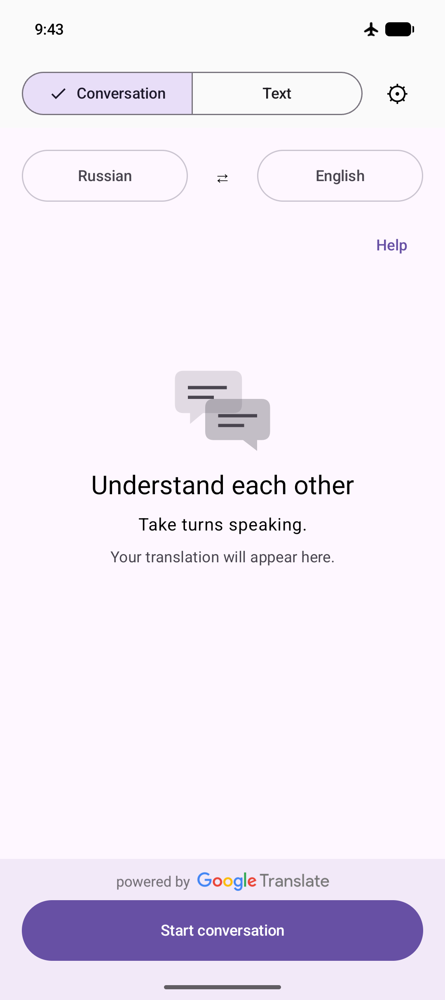
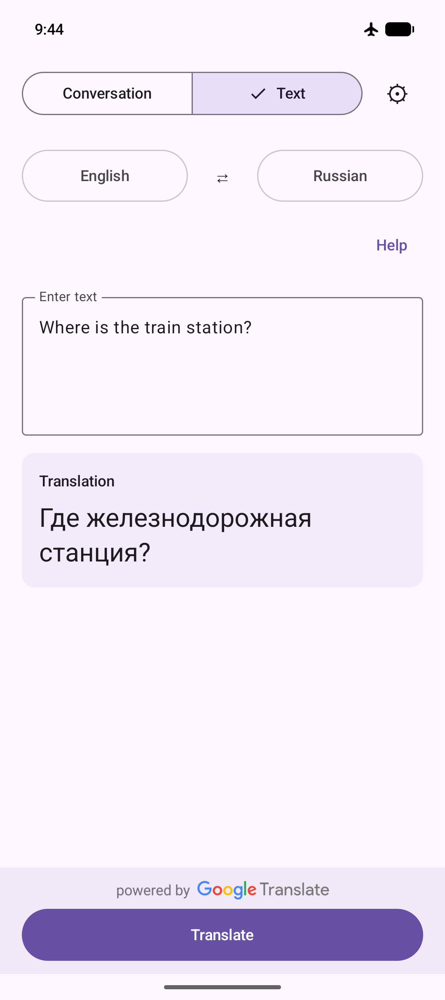
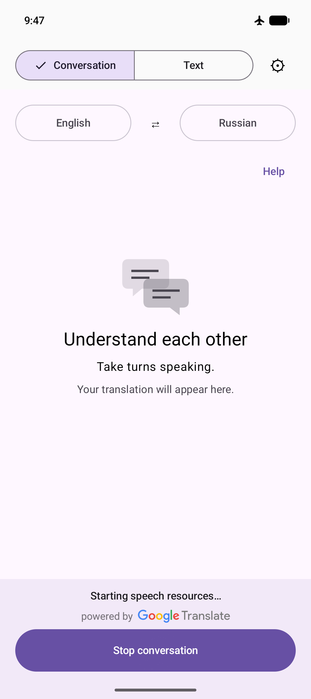
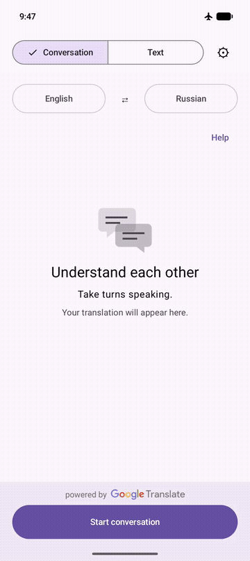
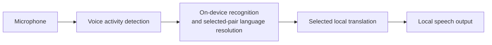

# Offline Conversation Translator

**Two people. One Android phone. A conversation across languages — with recognition, translation and speech running on the device.**

> **Status:** working development project, not a production-qualified release. Language resources must be prepared online before offline use. Available speech languages depend on the device and its installed services.

## See it working

<p>
  
  
  
</p>

[Language preparation help](docs/media/language-preparation-help.png) · [Watch the 12-second offline conversation with sound](docs/media/offline-conversation.mp4)



Recorded on an emulator with networking disabled and languages prepared. Test audio passes through the real recognition, translation and speech pipeline—not a live human microphone demo. [Capture details and limits](docs/media/README.md).

## The experience

Choose two languages, prepare their resources, and start a conversation. Either person can speak a turn; the app recognizes, translates and reads it aloud. Listening resumes after playback. **Text** uses the same language pair without the microphone.

- **Local processing:** ML Kit translation and Android on-device speech by default, with no automatic cloud or other-provider fallback.
- **Optional engines:** Tencent Hy-MT2 translation, plus Sherpa recognition and Piper speech for the curated Russian/English setup.
- **16 languages:** a shared language pair across Conversation and Text, with a localized interface.

The catalog includes English, Vietnamese, Spanish, Indonesian, Italian, Mainland Simplified Mandarin, Korean, German, Polish, Portuguese, Russian, Thai, Turkish, French, Hindi and Japanese. Offline recognition and voices depend on the device; translation quality varies by pair.

## How it works



Language downloads happen before use, not during translation. ML Kit may translate non-English pairs through English. See the [architecture guide](docs/EXTENSIBILITY.md) for modules, engine contracts and extension points.

## Build and run

- **JDK 17**, with `JAVA_HOME` configured.
- **Android SDK platform 37.0** (`platforms;android-37.0`), Build Tools **36.0.0** and current SDK command-line tools; set `ANDROID_HOME`.
- An Android **14 / API 34+** emulator or device. The app targets API 36 and packages `arm64-v8a` and `x86_64`.

Native preparation needs network access but does not download language models. It requires Linux x86_64; on Windows use PowerShell 7 and WSL Ubuntu with Python 3 and Git. See [environment setup](CONTRIBUTING.md#development-environment) for full prerequisites.

**Windows — PowerShell**

```powershell
pwsh -File tools/android/prepare-tencent-native.ps1
.\gradlew.bat :engine-sherpa:prepareSherpaArchive --console=plain
.\gradlew.bat :app:assembleDebug
```

**Linux**

```bash
python3 tools/android/prepare-tencent-native.py
bash ./gradlew :engine-sherpa:prepareSherpaArchive --console=plain
bash ./gradlew :app:assembleDebug
```

The APK is written to `app/build/outputs/apk/debug/app-debug.apk`.

Ordinary builds verify prepared native artifacts without downloading or rebuilding them. See [Contributing](CONTRIBUTING.md#baseline-host-checks) for artifact preparation, troubleshooting and verification commands.

After installation:

1. Choose the two languages.
2. Use **Prepare languages** while online and resolve any missing system recognition or voice resources.
3. Wait for readiness, then start Conversation and grant microphone permission—or use Text.
4. Disconnect networking to use the prepared app offline.

<details>
<summary>Optional provider setup: Android recognition and Tencent</summary>

### Explicit Android recognition service

**Settings → Recognition service** defaults to **Android on-device service**. You can explicitly select the supported Google **Speech Recognition and Synthesis** service instead. Both selected recognition languages must be installed; use **Install recognition language data** on Conversation when needed. See [service requirements and offline-policy boundaries](docs/EXTENSIBILITY.md#selected-recognition-and-request-local-routing).

Recognition and speech output are separate choices. **System offline speech** uses Android's default TTS engine and needs offline voices for both languages. For the reported GrapheneOS RU/EN setup, keep Google selected in Android's **Text-to-speech output → Preferred engine** as well as in the app's recognition setting. Switching the TTS default back to GrapheneOS Speech Services was reported to break Conversation; the exact error was not captured. There is no in-app TTS-engine selector.

### Tencent model preparation and boundaries

Choose **Tencent Hy-MT2** independently for Text or Conversation in Settings, then use **Prepare** over Wi-Fi to download the **1.13 GB** model. After reopening, Prepare initializes the verified local model without downloading it again. No model is bundled in the APK.

Tencent is experimental; ML Kit remains the default. Conversation targets **8 GiB or more RAM**, with phone performance still unqualified. Known output errors affect meaning, including dates and negation—verify important details. See the [pinned model identity](engine-tencent/THIRD_PARTY.md) and [results, resource limits and verification boundaries](docs/testing/verify-translator.md#tencent-specific-preparation-and-native-checks).

</details>

## Known limitations

- **Quality is not release-qualified.** Recognition and translation can change meaning; verify important details.
- **Conversation is turn-based.** Simultaneous translation and reliable interruption by speaking are not implemented.
- **Phone performance is unqualified.** Emulator checks do not establish real microphone/speaker behavior, sustained use or the two-second latency target.
- **Offline does not guarantee privacy.** Recognized/translated text was found in ML Kit native logs; this remains unresolved. Do not post private recordings or raw logs.
- **Third-party terms still apply.** The project license does not automatically cover runtimes, recordings, models, voices or provider branding.

See [native distribution conditions](engine-sherpa/THIRD_PARTY.md#conditions-before-redistributing-this-aar-or-an-apk-containing-it) before redistributing the runtime or an APK containing it.

## Explore the repository

- [Product vision](docs/APP_VISION.md) — intended experience and product requirements.
- [Architecture](docs/EXTENSIBILITY.md) — current structure and extension guidance.
- [Contributing](CONTRIBUTING.md) — setup, checks and safe bug reports.
- [Security policy](SECURITY.md) — reporting guidance and current channel availability.
- [Changelog](docs/CHANGELOG.md) — repository changes.
- [Android verification](docs/testing/verify-translator.md) — device checks and the limits of existing evidence.

## Development

Created by **[Daniil Sterkhov · Ngoroth](https://github.com/Ngoroth)** with AI-agent assistance in research, implementation, review and verification. Product direction and decisions remain human-led.

## License and attribution

Original project materials are licensed under **[Apache-2.0](LICENSE)**. Copyright 2026 **[Daniil Sterkhov · Ngoroth](https://github.com/Ngoroth)** and contributors.

Third-party components retain their own terms. Read [THIRD_PARTY_NOTICES](THIRD_PARTY_NOTICES.md) and [speech-runtime/model provenance](engine-sherpa/THIRD_PARTY.md) before redistributing binaries, recordings or model packages.
