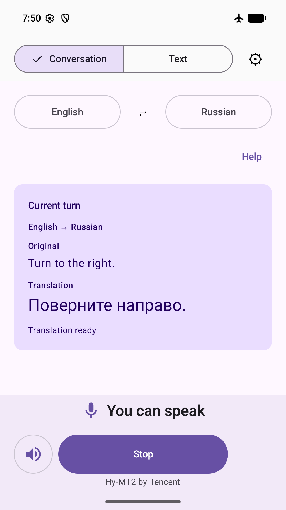
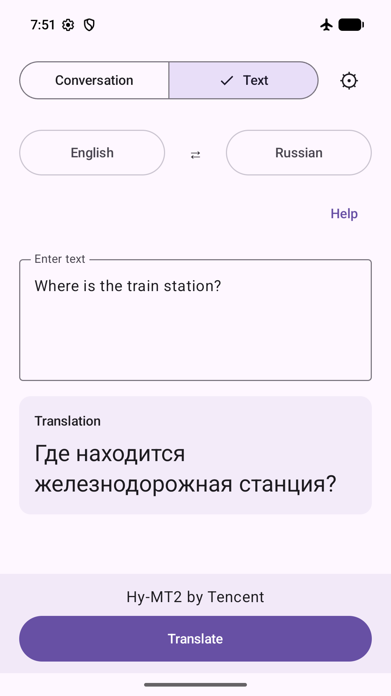
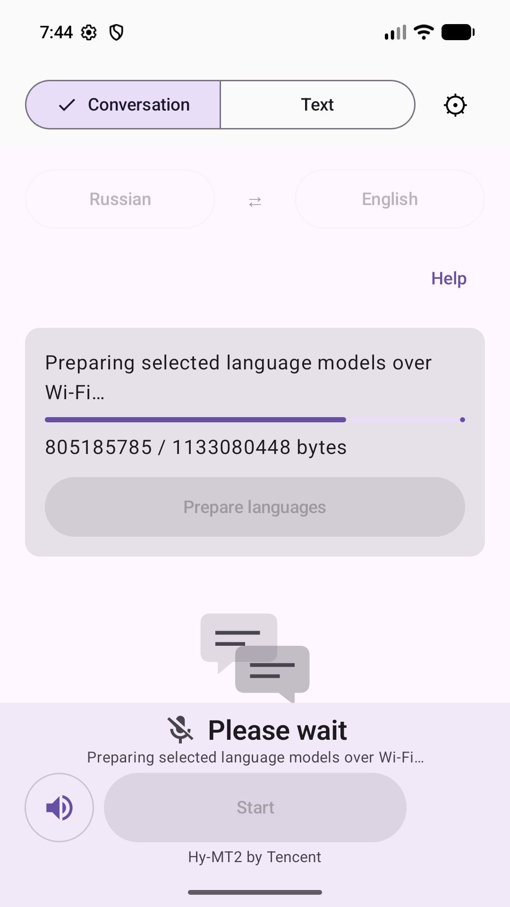
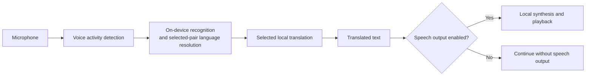

# Offline Conversation Translator

**Two people. One Android phone. A conversation across languages — with recognition, translation and speech running on the device.**

> **Status:** working development project. Language resources must be prepared online before offline use. Available speech languages depend on the device and its installed services.

## See it working

<p>
  
  
  
</p>

[Watch the 24-second offline conversation with sound](docs/media/tencent/offline-conversation.mp4)

Recorded on an emulator with networking disabled and languages prepared. Test audio passes through the real Whisper recognition → Tencent translation → local System speech pipeline—not a live human microphone demo. Processing is not sped up. The model-download screenshot shows online preparation, not offline inference. [Capture details and limits](docs/media/tencent/README.md).

## The experience

Choose two languages, prepare their resources, and start a conversation. Either person can speak a turn; the app recognizes and translates it. The speaker button beside Start/Stop enables or disables reading translations aloud. With speech output enabled, listening resumes after playback; with it disabled, synthesis and playback are skipped. **Text** uses the same language pair without the microphone.

- **Translation setup:** choose Mozilla or Tencent Hy-MT2 on first setup, before opening Text or Conversation. The saved choice is reused on later launches and can be changed in Settings. Existing completed selections are preserved; a failed save keeps entry blocked with explicit retry.
- **Speech alternatives:** Whisper is the recognition default; Android on-device recognition and System/Piper output remain in Advanced settings. Piper retains its curated Russian/English coverage.
- **Conversation controls:** the pinned lower panel shows actual microphone availability, independently of recognition/translation progress. Speech output is on by default and its choice survives reopening. Mute interrupts current speech without discarding translated text or stopping the conversation; enabling affects subsequent results, not old translations. Unavailable voices leave output off without switching providers or downloading implicitly. For supported Piper languages with missing voice data, Stop and explicitly prepare the voices; preparation keeps output off until you enable it again.
- **17 languages:** a shared language pair across Conversation and Text, with a localized interface.

Basic Settings contains the shared translation provider, interface language and voice speed; Advanced contains recognition/service, output, end-of-speech silence and Reset. Reset immediately restores Tencent, Whisper, System output and speech output on while preserving the language pair, interface language and completed setup. Ordinary Apply and pair changes preserve the latest speaker choice. Opening, selecting or resetting does not download models or record. Current settings retain schema 7. Schema-7 documents without the speaker flag default to on; older binaries cannot read the newly written field, so downgrading requires restoring their original settings first.

The catalog is `en`, `vi`, `es`, `id`, `it`, `zh`, `ko`, `de`, `pl`, `pt`, `ru`, `th`, `tr`, `fr`, `hi`, `ja`, `nl`. Chinese means Mainland Simplified Mandarin. Dutch uses catalog ID `nl` and `nl-NL` for Android recognition/output. Whisper covers the current 17 recognition codes through one shared Small INT8 download; it does not expand Piper voices or install System voices.

## How it works



Tencent uses one multilingual model invocation for each translation. Mozilla uses a direct model when English is an endpoint; other pairs translate through English internally. Source-language resolution follows the selected recognition backend's policy, and the original transcript remains visible. Downloads are a separate, explicit preparation step—not part of inference or provider selection.

Whisper uses one multilingual Small INT8 model and one encoder per utterance.
The same encoder output feeds a language-token comparison restricted to the two
selected languages and one transcription. It does not run a separate language
classifier or request repetition because the two language scores are close.
Native failures, invalid results and blank text still fail without translation.
Production VAD remains essential: a raw Whisper transcript, including one from
silence, is not by itself proof that someone spoke.

| Component | Responsibility |
| --- | --- |
| `app` | Compose UI, settings, Android speech adapters and runtime ownership |
| `core` | Language/configuration types, engine contracts and conversation processing |
| `speech-models` | Shared strict catalog, verified package storage, download and installation |
| `engine-tencent` | Shared pinned GGUF preparation and owner-scoped embedded CPU llama.cpp JNI inference |
| `engine-mozilla` | Selected-pair Firefox model preparation and owner-scoped native Bergamot inference, including English pivots |
| `engine-sherpa` | Native VAD, joint selected-pair Whisper, retained evaluator ASR and Piper synthesis |
| `translator-test-kit` | Shared evaluation inputs and utilities |
| `engine-sherpa-model-smoke` | Isolated Android/JNI model-evaluation runner |
| `build-logic` | Gradle verification tooling, with its own JVM tests |

See the [architecture and extension guide](docs/EXTENSIBILITY.md) for the actual contracts and extension points.

## Build and run

- **JDK 17**, with `JAVA_HOME` configured.
- **Android SDK platform 37.0** (`platforms;android-37.0`), Build Tools **36.0.0** and current SDK command-line tools; set `ANDROID_HOME`.
- An Android **14 / API 34+** emulator or device. The app targets API 36 and packages `arm64-v8a` and `x86_64`.
- **Python 3.12+** to prepare the Tencent and Mozilla native distributions. Their compilation requires Linux x86_64 (including WSL) and pinned toolchains. Sherpa and Piper Phonemize are acquired as official Android AARs, with no local native compilation.

Native preparation needs network access but does not download language models. On Windows, use PowerShell 7 and WSL Ubuntu with Python 3 and Git for Tencent and Mozilla; the Sherpa Gradle task runs directly on Windows or POSIX. See [environment setup](CONTRIBUTING.md#development-environment) for full prerequisites.

**Windows — PowerShell**

```powershell
pwsh -File tools/android/prepare-tencent-native.ps1
pwsh -File tools/android/prepare-mozilla-native.ps1
.\gradlew.bat :engine-sherpa:prepareSherpaArchive --console=plain
```

**Linux**

```bash
python3 tools/android/prepare-tencent-native.py
python3 tools/android/prepare-mozilla-native.py --installed-tools engine-tencent/.native-cache/tools
bash ./gradlew :engine-sherpa:prepareSherpaArchive --console=plain
```

The APK is written to `app/build/outputs/apk/debug/app-debug.apk`.

The application ID is `io.github.ngoroth.offlinetranslator`. It installs separately
from earlier `com.example.offlinetranslator` builds; settings and downloaded models
are not migrated. Owned Kotlin packages and source namespaces now also use
`io.github.ngoroth.offlinetranslator`; updating an existing same-ID installation
preserves its settings and downloaded models.

`:engine-sherpa:prepareSherpaArchive` explicitly acquires the official
`sherpa-onnx-2.0.2.aar` and `piper-phonemize-1.5.9.aar` in `engine-sherpa/libs/`.
It verifies the pinned size and SHA-256 of each and reuses valid local copies
offline. Normal builds verify both local AARs without downloading, rebuilding
or repairing them. Only `arm64-v8a` and `x86_64` are packaged in the app.
See [artifact identities, build provenance and licenses](engine-sherpa/THIRD_PARTY.md).

After preparing the native dependencies, assemble with `.\gradlew.bat :app:assembleDebug`
on Windows or `bash ./gradlew :app:assembleDebug` on Linux/macOS.

### Multilingual Whisper recognition

Whisper is selected by default and remains available in Advanced Settings alongside
Android on-device recognition. The shared model has 375,485,327 bytes across three
verified raw packages; installation also requires temporary headroom. It needs
neither Android recognition-language packs nor a separate language-ID model.
For each turn, Whisper restricts recognition to the selected pair through
sherpa-onnx's upstream `language_candidates` option.
System output still needs genuine offline voices for both participants.

The legacy Russian/English Sherpa conversation recognizer and its separate
language-ID path have been retired. Native VAD and evaluator ASR remain.
Piper uses the separately packaged offline phonemizer and the existing
Russian/English voice downloads. First-launch translation selection is saved
atomically with setup completion before either main route opens; restart does
not repeat completed setup.

After installation:

1. Choose Mozilla or Tencent during first setup, then choose the two languages.
2. Use **Prepare languages** while online and resolve missing recognition resources. With speech output enabled, also prepare the selected voices. Switch the speaker button off to converse without output-only voice requirements.
3. Wait for readiness, then start Conversation and grant microphone permission—or use Text.
4. Disconnect networking to use the prepared app offline.

<details>
<summary>Provider preparation and Android recognition</summary>

### Explicit Android recognition service

To use System recognition instead of Whisper, explicitly select it in Settings and Apply. Its **Recognition service** preference defaults to **Android on-device service**; you can explicitly select the supported Google **Speech Recognition and Synthesis** service instead. Both selected recognition languages must be installed; use **Install recognition language data** on Conversation when needed. See [service requirements and offline-policy boundaries](docs/EXTENSIBILITY.md#selected-recognition-and-request-local-routing).

Recognition and speech output are separate choices. **System offline speech**, when enabled, uses Android's default TTS engine and needs offline voices for both languages. Disabling output does not replace missing recognition or translation resources. For the reported GrapheneOS RU/EN setup, keep Google selected in Android's **Text-to-speech output → Preferred engine** as well as in the app's recognition setting. Switching the TTS default back to GrapheneOS Speech Services was reported to break Conversation; the exact error was not captured. There is no in-app TTS-engine selector.

### Tencent model preparation and boundaries

Tencent Hy-MT2 remains available in Settings; Reset selects it. Use **Prepare** over Wi-Fi to download the **1.13 GB** model. On entry, both Text and Conversation initialize verified installed models locally when needed; they never download or repair them implicitly. Conversation also requires the selected speech resources. Foreground mode/direction switches retain a compatible prepared translator; backgrounding, memory pressure or a provider/pair change releases it after native work drains. No model is bundled in the APK.

Conversation targets **8 GiB or more RAM**. See the [pinned model identity](engine-tencent/THIRD_PARTY.md) and [preparation guide](docs/testing/verify-translator.md#tencent-specific-preparation-and-native-checks).

### Mozilla model preparation

Mozilla prepares only the models, vocabularies and shortlists needed for both directions of the selected pair. Pairs without English use English internally as a pivot. Downloads and repairs require explicit **Prepare** over Wi-Fi; verified resources are reused offline. Current catalog coverage includes explicit tiny models for seven English-hub directions, not a hidden provider fallback.

See [Mozilla source and license provenance](engine-mozilla/THIRD_PARTY.md) and the [verification guide](docs/testing/verify-translator.md). Historical Tencent screenshots above still describe their captured build, not Mozilla performance or interface proof.

</details>

## Known limitations

- **Conversation is turn-based.** Simultaneous translation and reliable interruption by speaking are not implemented.
- **Privacy.** Translation is processed on the device. The app does not save a text history. Do not post private recordings or raw logs. Optional Android speech services have their own privacy terms; see the [privacy policy](docs/privacy-policy.md).
- **Third-party terms still apply.** The project license does not automatically cover runtimes, recordings, models, voices or provider branding.

See [native distribution conditions](engine-sherpa/THIRD_PARTY.md#conditions-before-redistributing-this-aar-or-an-apk-containing-it) before redistributing the runtime or an APK containing it.

## Explore the repository

- [Product vision](docs/APP_VISION.md) — intended experience and product requirements.
- [Architecture](docs/EXTENSIBILITY.md) — current structure and extension guidance.
- [Contributing](CONTRIBUTING.md) — setup, checks and safe bug reports.
- [Security policy](SECURITY.md) — reporting guidance and current channel availability.
- [Changelog](docs/CHANGELOG.md) — repository changes.
- [Android verification](docs/testing/verify-translator.md) — device checks and the limits of existing evidence.

## Development

Created by **[Daniil Sterkhov · Ngoroth](https://github.com/Ngoroth)** with AI-agent assistance in research, implementation, review and verification. Product direction and decisions remain human-led.

## License and attribution

Original project materials are licensed under **[Apache-2.0](LICENSE)**. Copyright 2026 **[Daniil Sterkhov · Ngoroth](https://github.com/Ngoroth)** and contributors.

Third-party components retain their own terms. Read [THIRD_PARTY_NOTICES](THIRD_PARTY_NOTICES.md) and [speech-runtime/model provenance](engine-sherpa/THIRD_PARTY.md) before redistributing binaries, recordings or model packages.
