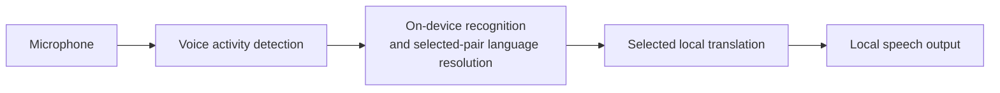

# Offline Conversation Translator

**Two people. One Android phone. A conversation across languages — with recognition, translation and speech running on the device.**

Created by **[Daniil Sterkhov · Ngoroth](https://github.com/Ngoroth)** as a showcase of human-directed software development with AI agents.

> **Status:** working development project, not a production-qualified release. Language resources must be prepared online before offline use. Available speech languages depend on the device and its installed services.

## See it working

<p>
  
  
  
</p>

[Language preparation help](docs/media/language-preparation-help.png) · [Watch the 12-second offline conversation with sound](docs/media/offline-conversation.mp4)


This is the actual app on an emulator with networking disabled and languages already prepared. Recorded test audio enters the real microphone/VAD/recognition path; it is not a live human microphone demonstration. The observed translation and speech output are preserved, including the displayed wording. Only idle waiting before the audio input was trimmed; no inference was sped up. [Capture details, attribution and limits](docs/media/README.md).

## The experience

Choose two languages, prepare their resources, and start a conversation. Either person can speak a turn. The app recognizes the speech, determines its source within the selected pair, translates it, and reads the result aloud. Listening pauses during playback and resumes afterward.

For situations where speaking is inconvenient, **Text** uses the same language pair without starting the microphone or speech pipeline.

- **On-device processing:** the conversation path uses local recognition, selected ML Kit or Tencent Hy-MT2 translation and local speech output. ML Kit remains the default. Missing resources do not trigger a cloud or other-provider fallback.
- **Explicit preparation:** download the required resources before use. Missing, unavailable or failed preparation stays visible rather than being presented as ready.
- **One shared language pair:** change or swap the pair in either Conversation or Text.
- **Replaceable speech backends:** Android on-device recognition and speech output are the defaults; Sherpa recognition and Piper output remain selectable for the curated Russian/English setup.
- **Independent translation choices:** Settings selects the real text and conversation providers independently without changing recognition, voices or the shared pair.
- **A multilingual interface:** app-owned interface text is localized for the same 16-language catalog.

The catalog is `en`, `vi`, `es`, `id`, `it`, `zh`, `ko`, `de`, `pl`, `pt`, `ru`, `th`, `tr`, `fr`, `hi`, `ja`. Chinese means Mainland Simplified Mandarin. A catalog entry does **not** guarantee an installed local recognizer/voice or qualified translation quality for every pair.

## Why this is an AI-agent showcase

The project explores how to take an Android application beyond a generated demo: define the product, integrate real on-device engines, handle resource ownership and cancellation, and check the resulting behavior.

**The author directs the work.** Product goals, constraints and decisions belong to the human; AI agents assist with repository research, implementation, independent review and verification. Current capabilities and unresolved limitations are documented below; internal development journals are kept locally.

Concrete engineering concerns include:

- keeping one conversation pipeline while replacing recognition and speech-output implementations;
- coordinating model preparation, settings changes and engine lifetimes;
- verifying downloaded archives and bounding audio, queues and transcript history;
- distinguishing unit/build checks from actual Android, speech-quality and performance evidence.

Lifecycle, bounded-work and input-limit fixes are summarized in the [changelog](docs/CHANGELOG.md). See the [Android verification guide](docs/testing/verify-translator.md) for current checks.

## How it works



ML Kit can use English as an intermediary for non-English pairs. The app does not treat ambiguous recognition as a reliable source-language decision. Downloads are a separate, explicit preparation step—not part of inference.

| Component | Responsibility |
| --- | --- |
| `app` | Compose UI, settings, Android speech adapters and runtime ownership |
| `core` | Language/configuration types, engine contracts and conversation processing |
| `engine-mlkit` | Default ML Kit on-device text translation |
| `engine-tencent` | Pinned Hy-MT2 GGUF preparation and embedded CPU llama.cpp JNI translation |
| `engine-sherpa` | Native VAD, retained recognition/language identification, model storage and Piper synthesis |
| `translator-test-kit` | Shared evaluation inputs and utilities |
| `engine-sherpa-model-smoke` | Isolated Android/JNI model-evaluation runner |
| `build-logic` | Gradle verification tooling, with its own JVM tests |

See the [architecture and extension guide](docs/EXTENSIBILITY.md) for the actual contracts and extension points.

## Build and run

### Requirements

- **JDK 17**, with `JAVA_HOME` configured.
- **Android SDK platform 37.0** (`platforms;android-37.0`), Build Tools **36.0.0** and current SDK command-line tools; set `ANDROID_HOME`.
- An Android **14 / API 34+** emulator or device. The app targets API 36 and packages `arm64-v8a` and `x86_64`.

The checked-in Gradle wrapper supplies Gradle. Explicit native preparation requires network access for pinned sources/tools and build dependencies, but never downloads translation or speech weights. Tencent preparation uses Linux x86_64; on Windows install WSL Ubuntu with Python 3 and Git, and use PowerShell 7.

**Windows — PowerShell**

```powershell
pwsh -File tools/android/prepare-tencent-native.ps1
.\gradlew.bat :engine-sherpa:prepareSherpaArchive --console=plain
.\gradlew.bat :app:assembleDebug
```

**Linux**

```bash
python3 tools/android/prepare-tencent-native.py
bash ./gradlew :engine-sherpa:prepareSherpaArchive --console=plain
bash ./gradlew :app:assembleDebug
```

The APK is written to `app/build/outputs/apk/debug/app-debug.apk`.

The explicit preparation command downloads the official Sherpa 1.13.8 AAR (50,129,134 bytes) to ignored local path `engine-sherpa/libs/sherpa-onnx-1.13.8.aar`, verifies SHA-256 `633c24321e06b1fe79feafa03ea16cbc0f8a286641e2da3559bac91bdb13bd96`, and reuses valid local bytes without network access. Ordinary builds verify this file but never download it. A corrupt existing file fails unchanged: inspect/remove it explicitly before preparing again. This is the same ASR/VAD/Piper runtime, not a native rebuild or a model download. See the [native distribution record](engine-sherpa/THIRD_PARTY.md) for unchanged third-party conditions; removing the file from the current source tree does not remove historical Git blobs.

Tencent native preparation builds both ABIs with isolated NDK r29-beta1, CMake 4.2.3 and Ninja 1.13.2 into an ignored local AAR. Ordinary builds verify its checksum, ABI inventory and current-source/recipe receipt without network or native rebuilds. Changes to native/build inputs require explicit preparation again; see [CONTRIBUTING](CONTRIBUTING.md) and [Tencent provenance](engine-tencent/THIRD_PARTY.md).

After installation:

1. Choose the two languages.
2. Use **Prepare languages** while online and resolve any missing system recognition or voice resources.
3. Wait for readiness, then start Conversation and grant microphone permission—or use Text.
4. To verify offline use, disconnect networking after preparation. Build compatibility alone does not establish device speech-service support.

### Explicit Android recognition service

Advanced **Settings → Recognition service** keeps **Android on-device service** as the default. You can instead select an installed service without relying on the ROM's designated on-device component. Apply saves the choice; Close discards the draft; Reset returns to the designated service without changing the language pair.

Listing a service does not establish readiness for offline conversation. The explicit route accepts only Google **Speech Recognition and Synthesis** component `com.google.android.tts/com.google.android.apps.speech.tts.googletts.service.GoogleTTSRecognitionService`, enabled/exported, with exactly one current signer matching `d22cc500299fb22873a01a010de1c82fbe4d061119b94814dd301dab50cb7678` or `7ce83c1b71f3d572fed04c8d40c5cb10ff75e6d87d9df6fbd53f0468c2905053`. There is no version allowlist. Unknown current signers or other components remain incompatible; removed/disabled saved services stay unavailable without substitution. An update invalidates cached readiness and active operations through the full version/update-time/signer identity; fresh checks are required.

For an admitted Google service, use **Install recognition language data** on Conversation when a selected language is missing. The app opens Google's public confirmation for one missing selected locale. Cancel or return only causes a fresh readiness check; it never starts recording, assumes installation succeeded, or automatically installs the next language. Prepare translation, VAD and local speech output separately with **Prepare languages**. Both recognition languages must actually be installed before Start.

**Recognition and speech output are separate choices.** Selecting Google under **Recognition service** does not select a text-to-speech engine. **System offline speech** still uses Android's default TTS engine, which must provide installed offline voices for both selected languages. For the reported GrapheneOS RU/EN setup, keep Google selected in Android's **Text-to-speech output → Preferred engine** as well as in the app's recognition-service setting. Returning the Android TTS default to GrapheneOS Speech Services was reported to break the conversation; the exact resulting error was not captured. This release does not add an independent in-app TTS-engine selector.

This is a trusted-Google-provider offline-request policy: both selected local languages must be installed, and explicit recognition requests prefer offline processing. Language inventory and `PREFER_OFFLINE` do not attest every requested capability or enforce network isolation inside the provider. The app trusts the authentic Google service to honor that contract; runtime errors or unavailable installer activities fail visibly without app-selected cloud/provider fallback or same-audio retry. Historical binary inspection covered ARM64 210683481 and x86_64 210683483; emulator execution does not prove actual ARM64/GrapheneOS behavior, universal future compatibility, provider-wide telemetry isolation or version-atomic attestation of Android's asynchronously bound process.


### Tencent model preparation and boundaries

Choose **Tencent Hy-MT2** separately for Text or Conversation in Settings. **Prepare** is the only model download and initialization action. One private no-backup `Hy-MT2-1.8B-Q4_K_M.gguf` serves all 16 languages and 240 distinct directed pairs: exactly **1,133,080,448 bytes** (1.13 GB), revision `a0c709d9fac510f2c807aa3af52872340dc37a4a`, SHA-256 `dc5f44fcf1fa496ee7ad725982c0c8c553a4de00259b53af84c4b89fb0c06699`. Progress includes bytes, verification and loading. Validated Wi-Fi is required only for downloading; installed bytes are cold-verified and reused locally after reopening. Tap Prepare again to initialize a new owner; this does not re-download a valid model. Corrupt bytes never become ready and require explicit repair.

Inference is embedded CPU-only llama.cpp `d8d92973c8c21bb4dd5d592f0fec26fe2cd1e654`, not a local HTTP server. Original input is limited to 4,096 UTF-16 units; only the inference copy normalizes CRLF and standalone CR to LF. The displayed source is unchanged. Context/output/token limits are errors, never silently truncated successes. Stop/replacement joins actual native work before releasing resources. No model is bundled in Git or the APK.

Generation uses deterministic **strict UTF-8-prefix-constrained greedy** decoding, not unconstrained greedy. It preserves an eligible greedy winner and tie ordering; otherwise it selects the highest-logit eligible token before commitment. Valid split characters and NUL are preserved; EOS is allowed only after a complete character. This is not output repair, a translation retry, sampling or a model/prompt change, and it does not establish correct meaning.

Conversation with Tencent targets **8 GiB or more RAM**; this is not phone-performance or quality certification. On an ordinary DND-off 8-GiB cold boot, synthetic RU↔EN System ASR→Tencent→local System TTS completed, and the installed-ready Sherpa→Tencent→Piper path completed RU→EN. An OS-force-stopped new process also completed new Text and full System-speech Conversation in the same real MainActivity, with only synthetic PCM capture substituted. These are functional checks, not microphone/speaker, all-16-language speech, sustained-load or thermal qualification. Retain the 4-GiB LOW_MEMORY failures and earlier System-output initialization failure separately; the successful 8-GiB checks do not establish 4-GiB compatibility. See the [results and verification boundaries](docs/testing/verify-translator.md#tencent-specific-preparation-and-native-checks).

Actual Conversation playback interruption was also exercised for Stop, HOME/reentry and language changes, followed by healthy turns and legal idle provider replacement. Targeted external observation confirmed real AudioTrack onset and release without relying on the emulator profiler's unreliable timestamps; this is not a playback-latency or physical-speaker measurement.

Tencent remains an **experimental additional provider**; ML Kit stays the default. Observed Q4_K_M output can alter platform/station distinctions, per-person/per-ticket price basis, negation and dates: a Hindi-to-Chinese sample changed tomorrow to yesterday. Four Indonesian-target results were the classifier's leading language choice but below the frozen confidence threshold; they remain failed language checks, not proven wrong-language translations. Verify important details; catalog coverage and completed generation do not establish faithful meaning.

The [contributor guide](CONTRIBUTING.md) contains environment setup, the complete host checks and the separate build-logic test command. [Android verification guidance](docs/testing/verify-translator.md) covers opt-in device checks. The [host workflow](.github/workflows/host-checks.yml) runs unit tests, lint and debug APK assembly; its presence is not evidence of a completed GitHub Actions run.

## Known limitations

- **Speech and translation quality are not release-qualified.** Known recognition and meaning errors remain; successful fixtures do not establish all-language or all-direction quality.
- **Conversation is turn-based.** Reliable speech-driven interruption and simultaneous spoken translation are not implemented.
- **Phone performance is not qualified.** Emulator evidence does not establish real microphone/speaker acoustics, sustained-call behavior or the two-second latency target.
- **Offline is not a complete privacy guarantee.** Historical checks found recognized/translated text in ML Kit native logs; this remains unresolved. Do not submit real conversation recordings or raw logs in public reports.
- **Third-party distribution questions remain.** The project license does not automatically cover native binaries, audio fixtures, model/voice weights, datasets or provider branding.

See [native distribution conditions](engine-sherpa/THIRD_PARTY.md#conditions-before-redistributing-this-aar-or-an-apk-containing-it) before redistributing the runtime or an APK containing it.

## Explore the repository

- [Product vision](docs/APP_VISION.md) — intended experience and product requirements.
- [Architecture](docs/EXTENSIBILITY.md) — current structure and extension guidance.
- [Contributing](CONTRIBUTING.md) — setup, checks and safe bug reports.
- [Security policy](SECURITY.md) — reporting guidance and current channel availability.
- [Changelog](docs/CHANGELOG.md) — repository changes.

## License and attribution

Original project materials are licensed under **[Apache-2.0](LICENSE)**. Copyright 2026 **[Daniil Sterkhov · Ngoroth](https://github.com/Ngoroth)** and contributors.

Third-party components retain their own terms. Read [THIRD_PARTY_NOTICES](THIRD_PARTY_NOTICES.md) and [speech-runtime/model provenance](engine-sherpa/THIRD_PARTY.md) before redistributing binaries, recordings or model packages.
