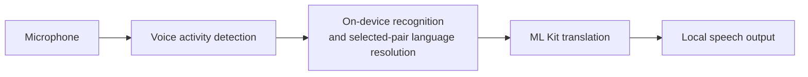

# Offline Conversation Translator

**Two people. One Android phone. A conversation across languages — with recognition, translation and speech running on the device.**

Created by **[Daniil Sterkhov · Ngoroth](https://github.com/Ngoroth)** as a showcase of human-directed software development with AI agents.

> **Status:** working development project, not a production-qualified release. Language resources must be prepared online before offline use. Available speech languages depend on the device and its installed services.

## See it working

<p>
  
  
  
</p>

[Language preparation help](docs/media/language-preparation-help.png) · [Watch the 12-second offline conversation with sound](docs/media/offline-conversation.mp4)


This is the actual app on an emulator with networking disabled and languages already prepared. Recorded test audio enters the real microphone/VAD/recognition path; it is not a live human microphone demonstration. The observed translation and speech output are preserved, including the displayed wording. Only idle waiting before the audio input was trimmed; no inference was sped up. [Capture details, attribution and limits](docs/media/README.md).

## The experience

Choose two languages, prepare their resources, and start a conversation. Either person can speak a turn. The app recognizes the speech, determines its source within the selected pair, translates it, and reads the result aloud. Listening pauses during playback and resumes afterward.

For situations where speaking is inconvenient, **Text** uses the same language pair without starting the microphone or speech pipeline.

- **On-device processing:** the conversation path uses local recognition, ML Kit translation and local speech output. Missing resources do not trigger a cloud fallback.
- **Explicit preparation:** download the required resources before use. Missing, unavailable or failed preparation stays visible rather than being presented as ready.
- **One shared language pair:** change or swap the pair in either Conversation or Text.
- **Replaceable speech backends:** Android on-device recognition and speech output are the defaults; Sherpa recognition and Piper output remain selectable for the curated Russian/English setup.
- **A multilingual interface:** app-owned interface text is localized for the same 16-language catalog.

The catalog is `en`, `vi`, `es`, `id`, `it`, `zh`, `ko`, `de`, `pl`, `pt`, `ru`, `th`, `tr`, `fr`, `hi`, `ja`. Chinese means Mainland Simplified Mandarin. A catalog entry does **not** guarantee an installed local recognizer/voice or qualified translation quality for every pair.

## Why this is an AI-agent showcase

The project explores how to take an Android application beyond a generated demo: define the product, integrate real on-device engines, handle resource ownership and cancellation, and check the resulting behavior.

**The author directs the work.** Product goals, constraints and decisions belong to the human; AI agents assist with repository research, implementation, independent review and verification. Current capabilities and unresolved limitations are documented below; internal development journals are kept locally.

Concrete engineering concerns include:

- keeping one conversation pipeline while replacing recognition and speech-output implementations;
- coordinating model preparation, settings changes and engine lifetimes;
- verifying downloaded archives and bounding audio, queues and transcript history;
- distinguishing unit/build checks from actual Android, speech-quality and performance evidence.

Lifecycle, bounded-work and input-limit fixes are summarized in the [changelog](docs/CHANGELOG.md). See the [Android verification guide](docs/testing/verify-translator.md) for current checks.

## How it works



ML Kit can use English as an intermediary for non-English pairs. The app does not treat ambiguous recognition as a reliable source-language decision. Downloads are a separate, explicit preparation step—not part of inference.

| Component | Responsibility |
| --- | --- |
| `app` | Compose UI, settings, Android speech adapters and runtime ownership |
| `core` | Language/configuration types, engine contracts and conversation processing |
| `engine-mlkit` | On-device text translation |
| `engine-sherpa` | Native VAD, retained recognition/language identification, model storage and Piper synthesis |
| `translator-test-kit` | Shared evaluation inputs and utilities |
| `engine-sherpa-model-smoke` | Isolated Android/JNI model-evaluation runner |
| `build-logic` | Gradle verification tooling, with its own JVM tests |

See the [architecture and extension guide](docs/EXTENSIBILITY.md) for the actual contracts and extension points.

## Build and run

### Requirements

- **JDK 17**, with `JAVA_HOME` configured.
- **Android SDK platform 37.0** (`platforms;android-37.0`), Build Tools **36.0.0** and current SDK command-line tools; set `ANDROID_HOME`.
- An Android **14 / API 34+** emulator or device. The app targets API 36 and packages `arm64-v8a` and `x86_64`.

The checked-in Gradle wrapper supplies Gradle. Building requires network access for build dependencies, but does not download speech models.

**Windows — PowerShell**

```powershell
.\gradlew.bat :engine-sherpa:prepareSherpaArchive --console=plain
.\gradlew.bat :app:assembleDebug
```

**Linux / macOS**

```bash
bash ./gradlew :engine-sherpa:prepareSherpaArchive --console=plain
bash ./gradlew :app:assembleDebug
```

The APK is written to `app/build/outputs/apk/debug/app-debug.apk`.

The explicit preparation command downloads the official Sherpa 1.13.8 AAR (50,129,134 bytes) to ignored local path `engine-sherpa/libs/sherpa-onnx-1.13.8.aar`, verifies SHA-256 `633c24321e06b1fe79feafa03ea16cbc0f8a286641e2da3559bac91bdb13bd96`, and reuses valid local bytes without network access. Ordinary builds verify this file but never download it. A corrupt existing file fails unchanged: inspect/remove it explicitly before preparing again. This is the same ASR/VAD/Piper runtime, not a native rebuild or a model download. See the [native distribution record](engine-sherpa/THIRD_PARTY.md) for unchanged third-party conditions; removing the file from the current source tree does not remove historical Git blobs.

After installation:

1. Choose the two languages.
2. Use **Prepare languages** while online and resolve any missing system recognition or voice resources.
3. Wait for readiness, then start Conversation and grant microphone permission—or use Text.
4. To verify offline use, disconnect networking after preparation. Build compatibility alone does not establish device speech-service support.

The [contributor guide](CONTRIBUTING.md) contains environment setup, the complete host checks and the separate build-logic test command. [Android verification guidance](docs/testing/verify-translator.md) covers opt-in device checks. The [host workflow](.github/workflows/host-checks.yml) runs unit tests, lint and debug APK assembly; its presence is not evidence of a completed GitHub Actions run.

## Known limitations

- **Speech and translation quality are not release-qualified.** Known recognition and meaning errors remain; successful fixtures do not establish all-language or all-direction quality.
- **Conversation is turn-based.** Reliable speech-driven interruption and simultaneous spoken translation are not implemented.
- **Phone performance is not qualified.** Emulator evidence does not establish real microphone/speaker acoustics, sustained-call behavior or the two-second latency target.
- **Offline is not a complete privacy guarantee.** Historical checks found recognized/translated text in ML Kit native logs; this remains unresolved. Do not submit real conversation recordings or raw logs in public reports.
- **Third-party distribution questions remain.** The project license does not automatically cover native binaries, audio fixtures, model/voice weights, datasets or provider branding.

See [native distribution conditions](engine-sherpa/THIRD_PARTY.md#conditions-before-redistributing-this-aar-or-an-apk-containing-it) before redistributing the runtime or an APK containing it.

## Explore the repository

- [Product vision](docs/APP_VISION.md) — intended experience and product requirements.
- [Architecture](docs/EXTENSIBILITY.md) — current structure and extension guidance.
- [Contributing](CONTRIBUTING.md) — setup, checks and safe bug reports.
- [Security policy](SECURITY.md) — reporting guidance and current channel availability.
- [Changelog](docs/CHANGELOG.md) — repository changes.

## License and attribution

Original project materials are licensed under **[Apache-2.0](LICENSE)**. Copyright 2026 **[Daniil Sterkhov · Ngoroth](https://github.com/Ngoroth)** and contributors.

Third-party components retain their own terms. Read [THIRD_PARTY_NOTICES](THIRD_PARTY_NOTICES.md) and [speech-runtime/model provenance](engine-sherpa/THIRD_PARTY.md) before redistributing binaries, recordings or model packages.
